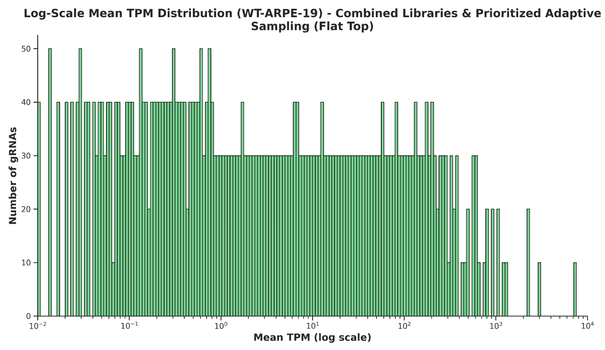
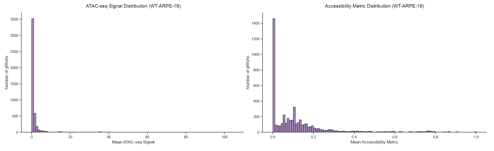
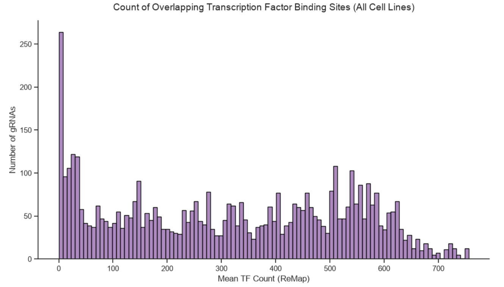
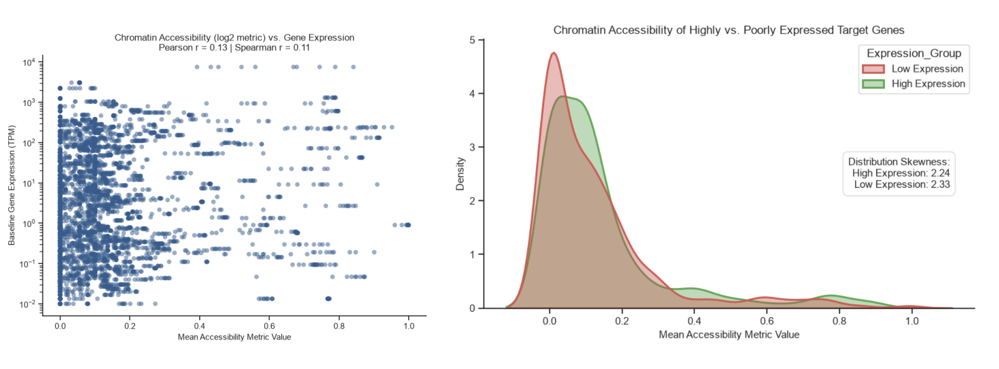
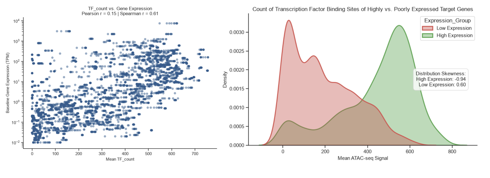

# CRISPR Residence Time Prediction Library Design

The purpose of this directory is to determine a suitable spread of gRNAs for an assay predicting the residence time of the CRISPR/dCas9 molecule at a specific site. 

# Introduction and Background

We hypothesize that mRNA delivery enables precise assessment of dCas9 retention over time. To test this, the first step is to construct a diverse gRNA library spanning varied chromatin parameters, quantify dCas9 residence times genome-wide via time-course ChIP-seq, and leverage these predictive features to engineer optimized gRNA libraries for epigenomic applications.

Kat Rosner's initial library focused on a targeted set of gRNAs selected across a broad gradient of baseline gene expression levels[1]. To characterize this foundational library, I profiled key regulatory features across all targeted loci in ARPE-19 cells. This repository focuses on profiling chromatin accessibility via a publicly available ATAC-seq dataset[2] and the density of general transcription factor (TF) binding sites[3].

# Results

The library is available in the csv file, "combined_libraries_prioritized_flat_top_distribution.csv".
 
All measurements were taken from publicly availabile datasets. Expression levels in KR's initial library were greatly varied (Figure 1). To quantify accessibility, I measured the ATAC-seq readouts of each gRNA. The distribution of ATAC-seq data which was heavily right-skewed (Figure 2, left). I used the following formula to give higher weight to gRNAs with very high ATAC-seq data (Figure 2, right):

*Accessibility Metric = log2(Raw ATAC-seq Data + 1), scaled from 0 to 1*

Finally, I measured the concentration of regulatory regions in the vicinity of each gRNA using a publicly available dataset. This dataset, known as ReMap, is derived from an integrative analysis of DNA-binding experiments in common eukaryotic cell lines; while definitely not perfect, I intended to use it as an approximation for relative concentration of TF binding sites surrounding each gRNA in ARPE-19 cells. This distribution mirrored that of the expression levels', being quite varied (Figure 3). Interestingly, correlation analyses between each metric and expression data showed a moderate correlation between TF Binding Site Data and Expression data (Figure 5), but little correlation between Accessibility and Expression (Figure 4), which runs contrary to expectations.

The curated gRNA library and corresponding multi-omic annotations are provided in combined_libraries_prioritized_flat_top_distribution.csv.

# Figures

Figure 1:

Figure 2:

Figure 3:

Figure 4:

Figure 5:

# Future Directions

I intend to assess more metrics surrounding these gRNAs based on what is available. Some examples of possible metrics include ChIP-seq on different histone marks as well as Hi-C data if available.

# References

(1) Horlbeck, M. A.; Gilbert, L. A.; Villalta, J. E.; Adamson, B.; Pak, R. A.; Chen, Y.; Fields, A. P.; Park, C. Y.; Corn, J. E.; Kampmann, M.; Weissman, J. S. Compact and Highly Active Next-Generation Libraries for CRISPR-Mediated Gene Repression and Activation. eLife 2016, 5, e19760. https://doi.org/10.7554/eLife.19760

(2) Li, J.; Chen, Y.; Wang, W.; Zhang, Y.; Su, G.; Wang, S. K.; Zhang, Y.; Yao, Y.; Wu, S.; Lu, W.; Zhang, K.; Qiao, C.; Li, S.; Li, H.; Cheng, C.-Y.; Liu, Y.; Wang, N. Linking Iris Cis-Regulatory Variants to Primary Angle-Closure Glaucoma Via Clinical Imaging and Multiomics. Invest. Ophthalmol. Vis. Sci. 2024, 65 (14), 18. https://doi.org/10.1167/iovs.65.14.18

(3) Hammal, F.; de Langen, P.; Bergon, A.; Lopez, F.; Ballester, B. ReMap 2022: A Database of Human, Mouse, Drosophila and Arabidopsis Regulatory Regions from an Integrative Analysis of DNA-Binding Sequencing Experiments. Nucleic Acids Res 2022, 50 (D1), D316–D325. https://doi.org/10.1093/nar/gkab996
